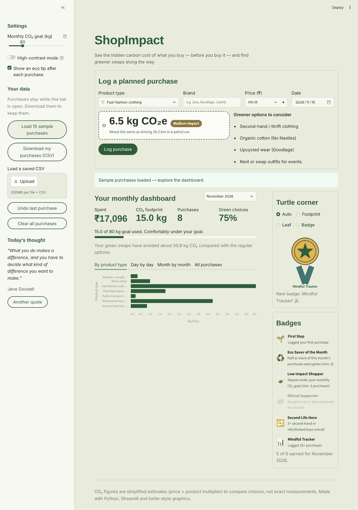
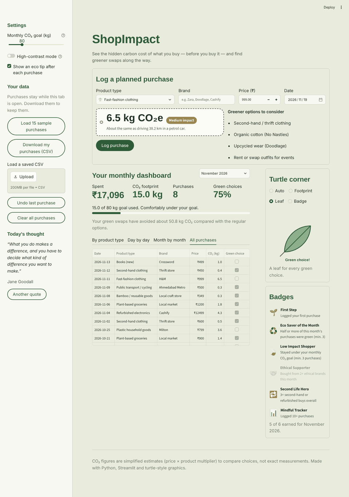
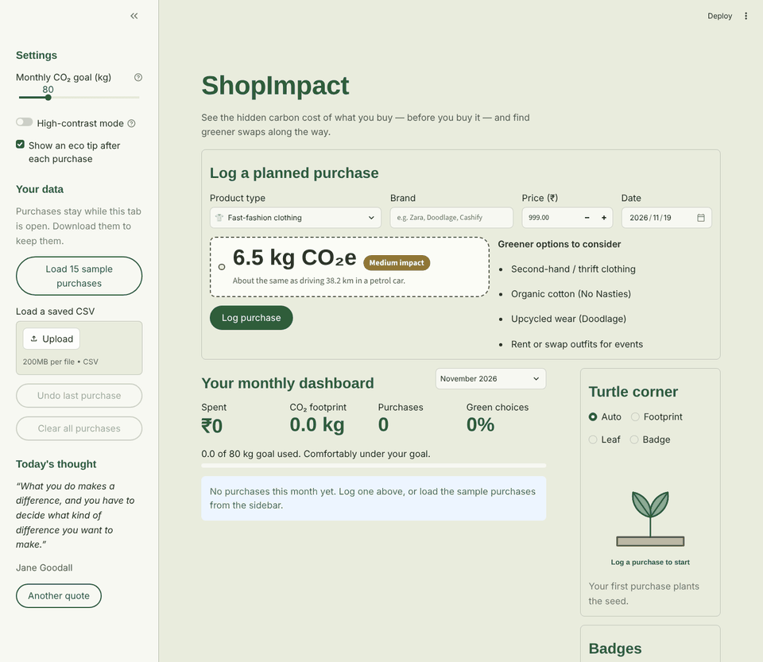

# 🌿 ShopImpact — Conscious Shopping Dashboard

**Live app:** https://shopimpact-thakkar.streamlit.app

ShopImpact shows the hidden carbon cost of everyday purchases before you buy. Log a planned purchase (product type, brand, price) and the app instantly estimates its CO₂ footprint, suggests greener alternatives, tracks your month on a live dashboard and rewards green choices with badges and turtle drawings.

Built for the CRS Artificial Intelligence — Python Programming summative (Scenario 1).

---

## Screenshots

| Dashboard with sample data | Purchases table + turtle leaf |
|---|---|
|  |  |



---

## Key features

**Core (compulsory)**
- **Inputs:** product type, brand, price and date.
- **Real-time CO₂ estimate:** a "CO₂ price tag" updates as you type, before you log anything, with a Low/Medium/High label and an everyday comparison (≈ km driven).
- **Monthly dashboard:** total spend, total CO₂, number of purchases, % green choices, a progress bar against your goal, and charts by product type, day by day and month by month.
- **Badges:** 🌱 First Step, ♻️ Eco Saver of the Month, 🍃 Low Impact Shopper, 🤝 Ethical Supporter, 🔁 Second Life Hero, 📊 Mindful Tracker. Locked badges show greyed out so users know what to aim for.
- **Greener alternatives:** every product type has its own list of swaps.
- **Turtle graphics:** a leaf for green choices, a medal for new badges, and a footprint coloured by your monthly status (green / yellow / red). Drawings animate as if a turtle is drawing them.

**Extras (creative / optional)**
- Random eco tip after each purchase
- Motivational quote of the day
- High-contrast mode for accessibility
- Monthly CO₂ goal slider
- "CO₂ avoided" counter for green swaps vs regular options
- Download and re-upload purchases as CSV (keeps data between visits)
- One-click sample data (15 purchases) for demos and testing
- Undo last purchase / clear all

---

## How the CO₂ estimate works

```
CO₂ (kg) = price (₹) × product multiplier
```

Each product type has a multiplier (kg CO₂e per ₹). Examples:

| Product type | Multiplier | ₹1,000 spent ≈ |
|---|---|---|
| Fuel / car trips | 0.0230 | 23.0 kg |
| Meat & poultry | 0.0100 | 10.0 kg |
| Leather shoes | 0.0090 | 9.0 kg |
| Fast-fashion clothing | 0.0065 | 6.5 kg |
| Second-hand clothing | 0.0008 | 0.8 kg |
| Public transport / cycling | 0.0005 | 0.5 kg |

Brands on the curated ethical list (e.g. Doodlage, No Nasties, Cashify) get a 15% lower estimate.

> The multipliers are simplified, illustrative values for comparing choices — not exact life-cycle measurements. The app says this on screen.

---

## Integration details

**Libraries**

| Library | Used for |
|---|---|
| `streamlit` | Web interface, widgets, session state, charts, file upload/download |
| `pandas` | Turning the purchase list into tables, grouping by month and product type |
| `datetime` | Purchase dates, grouping by month, default "today" |
| `random` | Eco tips and quotes |
| `math`, `base64` | Turtle geometry and embedding drawings |

**Project structure**

```
├── app.py              # Streamlit interface (layout, inputs, dashboard, turtle corner)
├── logic.py            # The "engine": data, CO₂ calculation, badges, messages
├── turtle_art.py       # SVGTurtle class + leaf / footprint / badge drawings
├── turtle_local.py     # Same drawings with Python's real turtle module (run locally)
├── requirements.txt
├── .streamlit/config.toml   # Earthy theme
├── tests/test_logic.py      # Unit tests (pytest)
├── docs/
│   ├── planning.md     # Stage 1: users, pain points, features, wireframe, ethics
│   ├── wireframe.svg
│   ├── testing_log.md  # Stage 4: test cases, results, fixes, feedback
│   └── Submission_Hrishit_Thakkar_ShopImpact.pdf  # Submission document
└── assets/             # Screenshots
```

**Data flow**

1. Inputs → `logic.calculate_impact()` gives a live estimate.
2. **Log purchase** → `logic.make_purchase()` builds a dictionary, appended to the `purchases` list in `st.session_state`.
3. Dashboard → `logic.monthly_summary()` and pandas `groupby` for charts.
4. `logic.earned_badges()` checks the rules; new badges trigger the turtle medal.
5. `turtle_art` draws the right picture and returns SVG shown in the side panel.

**Why turtle graphics are rendered as SVG**

Python's `turtle` module opens a desktop window with Tkinter, which doesn't exist on Streamlit Cloud's server, so `turtle.Screen()` crashes there. `turtle_art.py` contains `SVGTurtle`, a small class with the same commands as turtle (`forward`, `left`, `circle`, `penup`, `begin_fill`, `dot` ...). It records the turtle's path and outputs an SVG image the browser can display. `turtle_local.py` draws the same shapes with the real `turtle` module so you can see them in a window on your own computer.

---

## Deployment instructions

**Run locally**

```bash
git clone https://github.com/hrishitthakkar/IDAI1022105494-hrishitthakkar.git
cd IDAI1022105494-hrishitthakkar
pip install -r requirements.txt
streamlit run app.py
```

Optional: `python turtle_local.py` (real turtle window) and `pytest -q` (unit tests).

**Deploy on Streamlit Community Cloud**

1. Push this repo to GitHub (public, or private with access granted).
2. Go to [share.streamlit.io](https://share.streamlit.io) and sign in with GitHub.
3. Click **Create app** → **Deploy a public app from GitHub**.
4. Choose the repository, branch `main`, main file `app.py`.
5. Click **Deploy**. The app installs `requirements.txt` and goes live in a minute or two.
6. Copy the `.streamlit.app` link into the top of this README.

---

## Testing

- 11 unit tests in `tests/test_logic.py` cover the calculation, ethical discount, monthly totals, badge rules and goal status.
- `docs/testing_log.md` lists 15 test purchases with expected results, functional checks, fixes made during development and user feedback.

---

## Ethics & limitations

- CO₂ figures are estimates for comparison, not precise measurements.
- No accounts and no server storage — data stays in your browser session unless you download it.
- The ethical-brands list is a curated example, not an endorsement.
- Supportive, guilt-free messaging by design.

---

**Submission document:** [docs/Submission_Hrishit_Thakkar_ShopImpact.pdf](docs/Submission_Hrishit_Thakkar_ShopImpact.pdf)

**Author:** Hrishit Thakkar · CRS Artificial Intelligence · Python Programming
