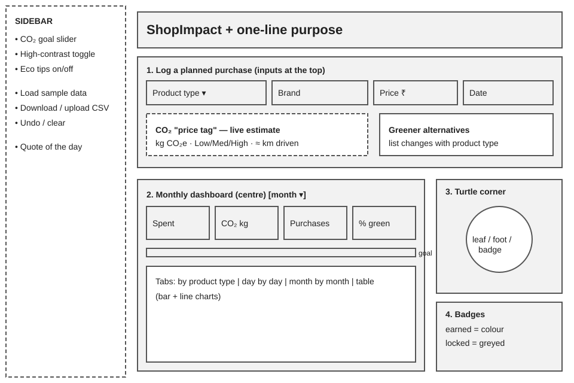

# Stage 1 — Understanding the problem & planning the design

## The problem

Most people know a flight or a car trip has a carbon cost, but almost nobody thinks about the footprint of a T-shirt, a pair of leather shoes or a new phone. That cost is hidden at the moment we buy. ShopImpact makes it visible *before* the purchase, when it can still change the decision, and keeps it light and encouraging rather than guilt-heavy.

## Who will use it

| User | Situation | What they need from the app |
|---|---|---|
| College student (18–22) | Shops online a lot, curious about sustainability, tight budget | Quick logging, clear numbers, cheap greener swaps (thrift, refurbished) |
| Young working adult | Earns their own money, buys electronics and clothes regularly | Monthly view of spending vs footprint, a goal to aim for |
| Eco-conscious family | Plans household purchases together | Simple, friendly interface; ideas for reusable/plastic-free options |

*(Add notes from 2–3 real people you show the plan to here — what they said they'd use it for.)*

## Pain points it solves

- People don't know the environmental impact of everyday purchases.
- "Being sustainable" feels vague; there's no simple number to track.
- Carbon calculators feel like homework — long forms, scary figures, no reward.
- Even when people want to change, they don't know what the greener alternative actually is.

## Emotions we want to create

Awareness (I can see the impact), empowerment (I know a better option), and fun (badges and drawings reward good choices). Guilt is deliberately avoided: messages never shame the user, a high-impact purchase gets "peek at the greener options next time", and going over the goal says "next month is a fresh start".

## User journey

1. Open the app → see a sprout drawing inviting the first purchase.
2. Pick a product type, type the brand and price → the CO₂ "price tag" updates instantly.
3. Read the greener alternatives beside it → decide.
4. Click **Log purchase** → friendly message + random eco tip; dashboard updates.
5. Green choice → turtle draws a leaf. New badge → turtle draws a medal.
6. Over the month → watch the progress bar against the goal and the charts by category.

## Feature mind-map

**Must-have (compulsory)**
- Inputs: product type, brand, price (+ date)
- Real-time CO₂ calculation (price × multiplier)
- Monthly dashboard: total spend + total CO₂
- Badges: Eco Saver of the Month, Low Impact Shopper (+ more)
- Greener alternatives for every product type
- Turtle graphics: leaf, footprint, badge

**Nice-to-have (optional — all built)**
- Random eco tip after each purchase
- High-contrast mode for accessibility
- Motivational quotes
- Monthly CO₂ goal slider
- "CO₂ avoided" counter from green swaps
- Everyday equivalent (≈ km driven)
- Download / upload purchases as CSV
- Sample data button for quick demos
- Animated turtle drawings that "draw themselves"

## Visual style

| Role | Colour | Why |
|---|---|---|
| Background | `#E9ECDD` oat-sage | Soft, natural, easy on the eyes |
| Primary / headings | `#2F5D3A` moss | Calm, clearly "eco" without neon green |
| Accent | `#3E7C98` river blue | Water/sky; used for tips and secondary charts |
| Earth | `#6B4F3A` bark brown | Grounded; borders, footprint outline |
| Status | `#8DB38B` / `#E2B33C` / `#B5543C` | Under goal / close / over |

**Type:** Bricolage Grotesque for headings (friendly, a bit playful), Atkinson Hyperlegible for body text — designed for readability and low vision. Base text is larger than default (≈18px).

**Layout (as the brief asks):** inputs at the top, dashboard in the centre, Turtle drawing and badges on the side, settings in the sidebar.

## Wireframe

*(Also attach your hand-drawn or Canva sketch here — the rubric rewards your own sketches.)*

## Data & logic plan

- `purchases` → a **list** of **dictionaries**: `date, product_type, brand, price, co2_kg, eco_choice, ethical_brand`
- `PRODUCTS` → **dictionary**: product type → multiplier, eco flag, emoji, list of greener alternatives
- `ETHICAL_BRANDS` → **list** of brands that get a 15% lower estimate
- Small functions, one job each: `calculate_impact`, `monthly_summary`, `earned_badges`, `goal_status`, `feedback_message`
- Dates handled with `datetime` to group purchases by month

### Badge rules

| Badge | Rule |
|---|---|
| 🌱 First Step | 1+ purchase logged |
| ♻️ Eco Saver of the Month | ≥ 50% of the month's purchases are green (min. 3) |
| 🍃 Low Impact Shopper | Month's CO₂ ≤ goal (min. 3 purchases) |
| 🤝 Ethical Supporter | 2+ ethical-brand purchases in the month |
| 🔁 Second Life Hero | 3+ second-hand / refurbished purchases |
| 📊 Mindful Tracker | 10+ purchases logged |

## Ethics & societal impact

- **Honesty about accuracy:** the multipliers are simplified estimates. The app says so on screen so users don't treat them as exact science.
- **No guilt, no shame:** behaviour change works better with encouragement; the tone is always supportive.
- **Privacy:** no login, nothing stored on a server. Purchases live only in the browser session unless the user downloads them.
- **Brand fairness:** the ethical-brands list is a curated example, not an endorsement; a real product would need transparent criteria.
- **Accessibility:** large fonts, high-contrast mode, colour is never the only signal (labels say "Low/Medium/High").
- **Bigger picture:** small individual choices add up, but the app also points to swaps (repair, second-hand, public transport) that reduce consumption, not just shift it.
